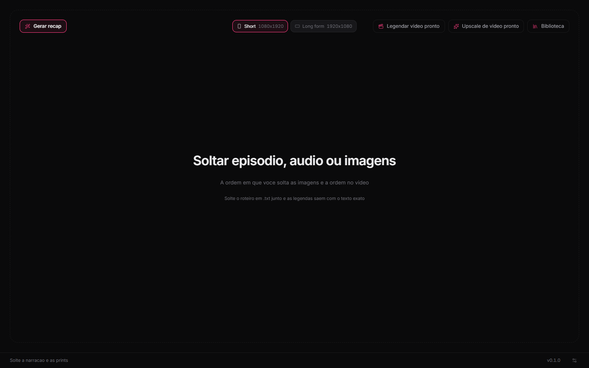
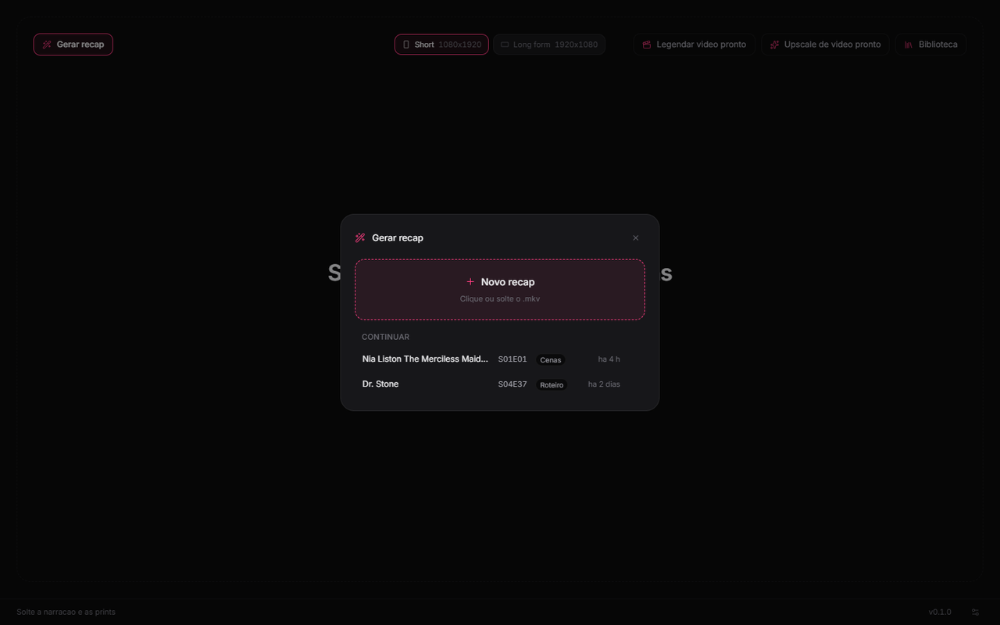
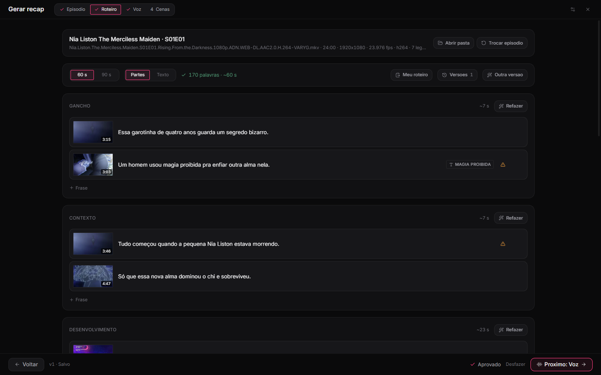
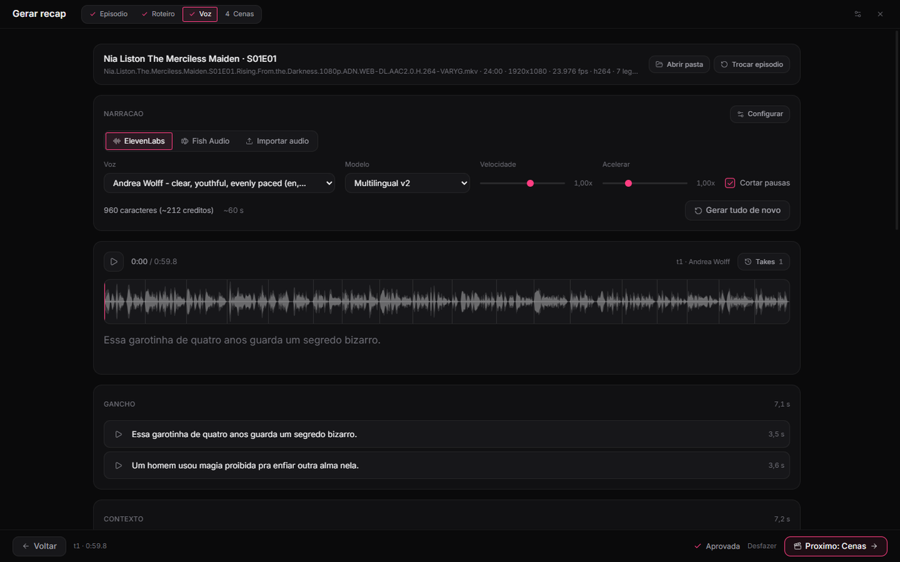
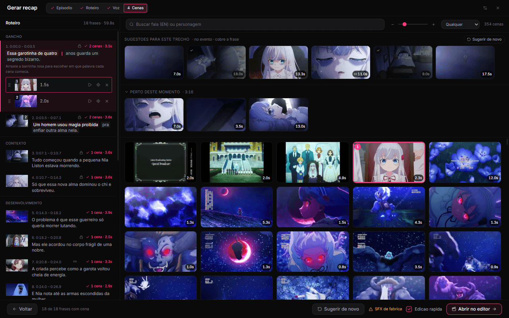
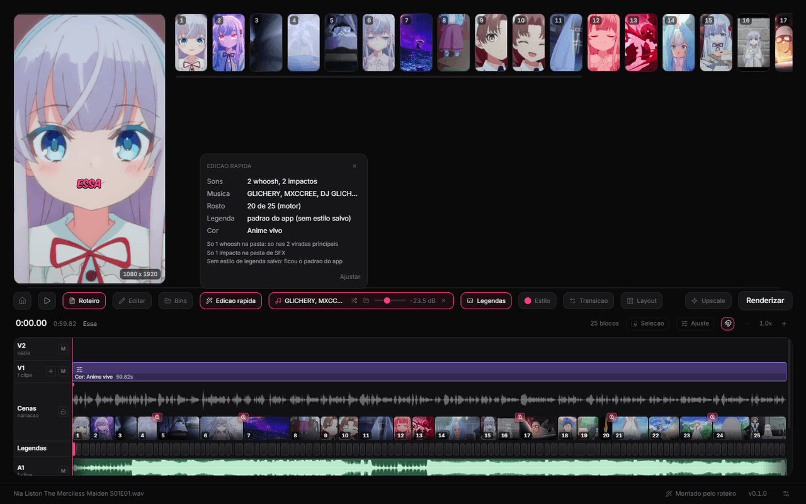
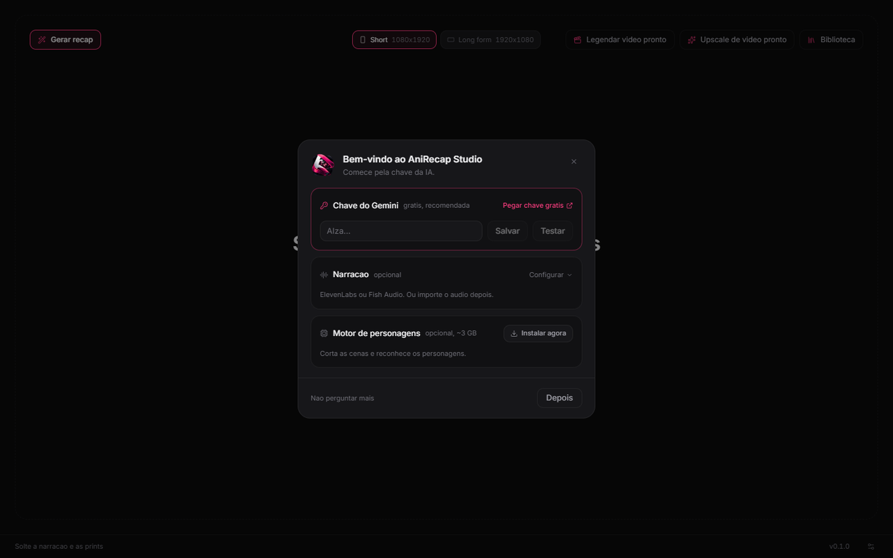
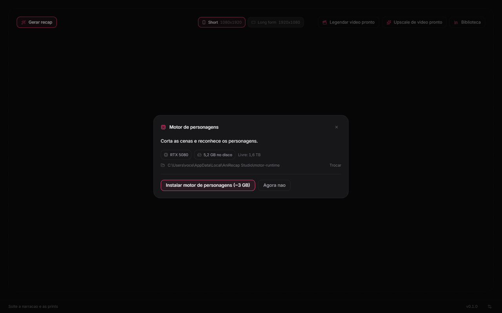

<p align="center">
  
</p>

<h1 align="center">AniRecap Studio</h1>

<p align="center">
  Recap de anime com IA: do episódio ao short 9:16, com roteiro, narração e as cenas do próprio episódio, pronto para editar.
</p>

<p align="center">
  <a href="https://github.com/leviclementino1-creator/anirecap-studio/releases/latest">
    
  </a>
</p>

<p align="center">
  
</p>

## Em 4 passos

<table>
  <tr>
    <td width="50%" valign="top">
      <b>1. Episódio</b><br>
      <b>Gerar recap</b> e solte o <code>.mkv</code>. Ou continue de onde parou.<br><br>
      
    </td>
    <td width="50%" valign="top">
      <b>2. Roteiro</b><br>
      A IA escreve para ~60 s. Edite frase a frase ou cole o seu.<br><br>
      
    </td>
  </tr>
  <tr>
    <td width="50%" valign="top">
      <b>3. Voz</b><br>
      ElevenLabs, Fish Audio ou o seu áudio. Velocidade e pausas no ajuste.<br><br>
      
    </td>
    <td width="50%" valign="top">
      <b>4. Cenas</b><br>
      As cenas do episódio, casadas com cada frase no tempo da fala.<br><br>
      
    </td>
  </tr>
</table>

## Edição rápida

**Abrir no editor** já monta o vídeo com sons, música com ducking, rosto
centralizado no 9:16, legenda e cor. Tudo continua editável, e um Ctrl+Z
desfaz.

<p align="center">
  
</p>

## Requisitos

- Windows 10 ou 11, 64 bits.
- Placa NVIDIA recomendada para o motor de personagens. Sem ela, o motor roda
  na CPU, mais devagar.
- ~6 GB livres para o motor. A instalação dele pede ~11 GB livres por alguns
  minutos.

## Primeiro uso

- **Chave do Gemini, grátis.** A tela de boas-vindas leva até
  [aistudio.google.com/apikey](https://aistudio.google.com/apikey) e testa a
  chave antes de salvar.
- **Aviso do SmartScreen.** O instalador não é assinado. Clique em
  **Mais informações > Executar assim mesmo**.
- **Motor de personagens, opcional.** Corta as cenas e reconhece os
  personagens. Instala com um clique (~3 GB, uma vez só) e fica fora da pasta
  do app.
- **Chaves cifradas no PC.** As chaves de IA e de voz ficam só nesta máquina,
  cifradas pelo Windows.

<table>
  <tr>
    <td width="50%"></td>
    <td width="50%"></td>
  </tr>
</table>

Instala só para o seu usuário, sem pedir administrador. Se o Smart App Control
barrar o instalador, a release também traz `AniRecap-Studio-<versão>-win-x64.zip`:
extraia por cima de `%LOCALAPPDATA%\Programs\anirecap-studio` com o app fechado.

## Atualização automática

O app procura versão nova ao abrir e a cada 6 h, baixa em segundo plano e
mostra **Atualizar para X** na barra de baixo. A troca só acontece no seu
clique. Seus projetos, as chaves e o motor ficam.

## Créditos

- **[Dangai](https://github.com/faahpla/dangai)**, de faahpla: a base inteira
  do app (editor, timeline, legendas e render).
- **[AnCut HUB](https://github.com/faahpla/ancut-hub-engine)**, de faahpla: o
  motor de personagens, que nasceu do **Corte Cenas**, de Levi Clementino.
- **[AniRecap](https://github.com/leviclementino1-creator/anirecap)**, de Levi
  Clementino: a geração do episódio ao short.
- Real-ESRGAN, lbpcascade_animeface, fonte Komika Axis e Remotion. Licenças e
  detalhes em [NOTICE](NOTICE).

## Desenvolvimento

Precisa de Node 24 e npm 11.

```bash
npm ci          # se o Electron nao baixar: node node_modules/electron/install.js
npm run dev     # app com recarga automatica
npm run build   # typecheck + bundles do Electron e do Remotion
npm run dist    # instalador em release/ (nunca publica)
```

**Motor em dev:** o app usa `motor/.venv` (Python 3.12 + torch, detalhes em
[motor/STUDIO.md](motor/STUDIO.md)). Com `ANIRECAP_MOTOR_RUNTIME=1`, o dev usa
o runtime instalado pela tela, como o app instalado.

**Publicar:** commit, `git push`, `git push origin vX.Y.Z` e o workflow
`release` do GitHub publica (ou `npm run release`; `-- --dry-run` ensaia sem
subir nada). O `scripts/release.mjs` explica o que ele confere antes.
